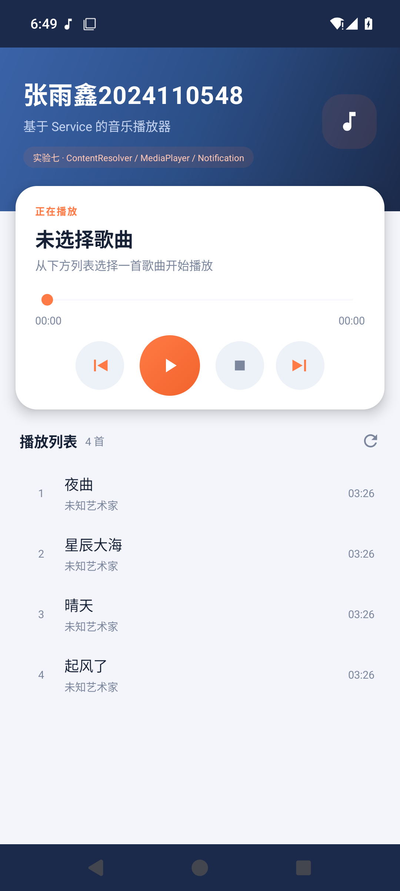
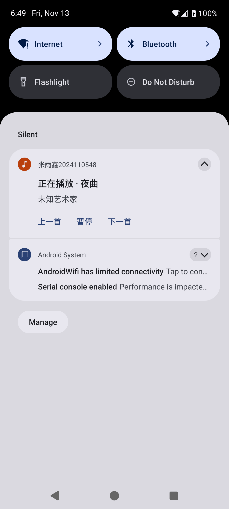
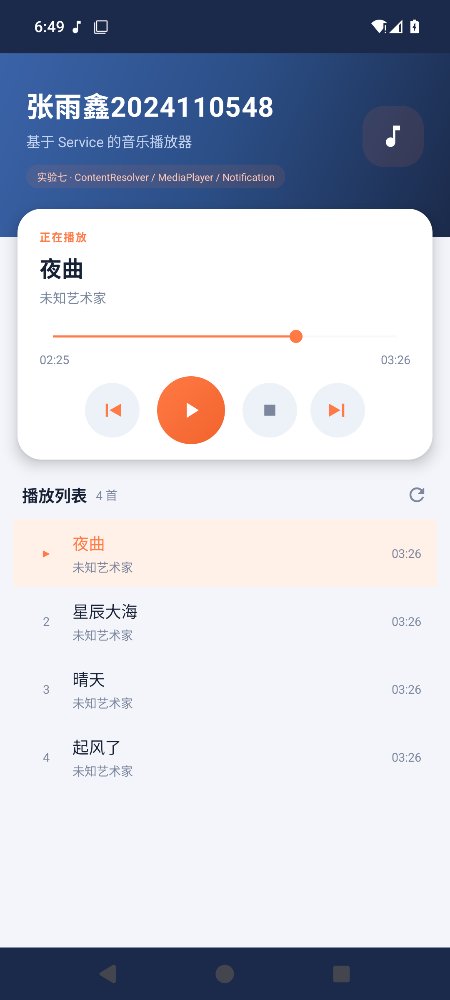
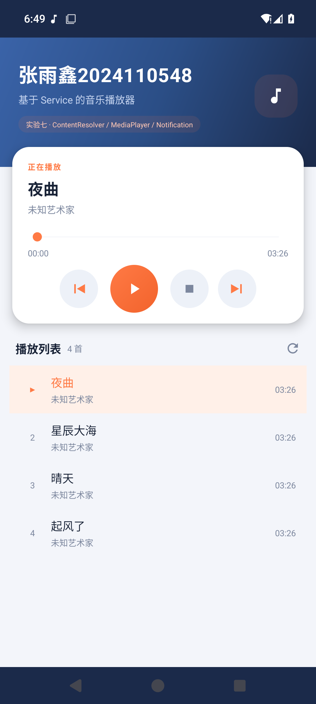

# 实验七 · 基于 Service 的音乐播放应用

四川师范大学 计算机科学学院 · Android 移动应用开发

| 项目 | 内容 |
| --- | --- |
| 姓名 / 学号 | 张雨鑫 / 2024110548 |
| 班级 | 2024 级 5 班 |
| 包名 | `cn.edu.sicnu.stu.zhangyuxin.seventh` |
| 开发环境 | Android Studio、Gradle 9.5、AGP 9.3、compileSdk 37、minSdk 23、targetSdk 34 |
| 运行环境 | Android 15（API 35）模拟器，1080×2400 |

## 功能

- 使用 `ContentResolver` 查询 `MediaStore.Audio.Media`，读取本机音乐列表（标题、艺术家、时长）。
- 播放、暂停、停止、上一首、下一首全部由 `MusicService`（`MediaPlayer`）实现，Activity 不直接操作播放器。
- Activity 通过 `bindService()` 取得 `MusicBinder`，读取当前歌曲、播放进度与播放状态。
- 独立线程每 200 ms 刷新 SeekBar 与时间文本，拖动 SeekBar 时暂停刷新，松手后调用 `seekTo()` 跳转。
- 前台 Service + `NotificationChannel`，换歌时通知标题同步为「正在播放 · 歌名」，通知内提供上一首 / 暂停 / 下一首按钮。
- Android 13（API 33）及以上申请 `READ_MEDIA_AUDIO` 与 `POST_NOTIFICATIONS`，低版本回退到 `READ_EXTERNAL_STORAGE`。

## 运行截图

| 歌曲列表 | 播放中 | 通知栏 |
| --- | --- | --- |
|  |  |  |

| 拖动进度后暂停 | 停止播放 |
| --- | --- |
|  |  |

## 项目结构

```
MusicPlayer/
├── app/src/main/java/cn/edu/sicnu/stu/zhangyuxin/seventh/
│   ├── MainActivity.java      # 界面、权限、音乐扫描、进度轮询、SeekBar
│   ├── MusicService.java      # MediaPlayer 播放控制、前台服务与通知
│   ├── Song.java              # 歌曲数据模型
│   └── SongAdapter.java       # 播放列表适配器
├── app/src/main/res/
│   ├── layout/                # activity_main.xml、item_song.xml
│   ├── drawable/              # 背景、按钮与矢量图标
│   └── values/                # 颜色、字符串、主题
├── app/src/main/AndroidManifest.xml
└── report/                    # 实验报告
```

## 构建

```bash
# Windows 下使用 Android Studio 自带 JDK
set JAVA_HOME=D:\android studio\jbr
gradlew.bat :app:assembleDebug
```

生成的 APK 位于 `app/build/outputs/apk/debug/app-debug.apk`。

## 实验报告

- [实验报告（Word）](report/实验七+基于Service的音乐播放应用_2024110548张雨鑫.docx)

## 说明

测试音频为本地合成的 4 段 WAV（夜曲、星辰大海、晴天、起风了），仅用于演示，未包含在仓库中。
